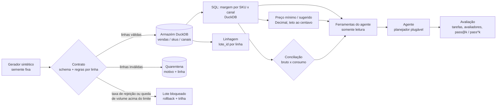

# Arquitetura

## Camadas e responsabilidades

| Camada | Módulo | Responsabilidade | Garantia testada |
|---|---|---|---|
| Regras de preço | `pricing.py` | Fórmulas com `Decimal`, teto ao centavo | Propriedades (Hypothesis): preço mínimo nunca dá prejuízo e 1 centavo a menos dá |
| Imposto | `tributos.py` | Alíquota efetiva Simples Anexo I | Contas de mão exatas; descontinuidade em R$ 3,6 mi documentada |
| Contrato | `pipeline/contracts.py` | Schema (falha o lote) e regras por linha (quarentena) | Entrada = válidas + rejeitadas, sempre |
| Armazém | `pipeline/store.py` | Carga idempotente, upsert, atomicidade, trilha, linhagem | Reenvio não altera estado; falha faz rollback |
| Controles | `pipeline/controls.py` | Conciliação de totais e frescor (SLA) | Detecta divergência injetada |
| Análise | `analysis.py` + `sql/` | Margem por SKU x canal em SQL | SQL e Python concordam |
| Agente | `agent/` | 6 ferramentas somente leitura, laço, transcrição | Nenhuma ferramenta altera o estado |
| Avaliação | `agent/evals/` | 42 tarefas, avaliadores de código, métricas, isolamento | Avaliadores reprovam respostas erradas em todas as tarefas |

## Fluxo de um lote

1. O lote ganha um identificador = hash do conteúdo (independe da ordem das linhas).
2. Se esse identificador já foi aceito, a carga é ignorada (idempotência).
3. O contrato separa linhas válidas das inválidas. Coluna ausente ou tipo errado derruba o lote.
4. Se a rejeição passa de 5% ou o volume cai mais de 50% contra o último lote aceito, o lote é
   bloqueado: nada é carregado, e a quarentena e a trilha registram a tentativa.
5. Caso contrário, upsert por (sku, canal, mês) dentro de uma transação, com o `lote_id` em cada linha.

Limites declarados: DuckDB é um motor embarcado de um único processo (ver ADR 0001); não há
orquestrador, backfill particionado nem concorrência de escritores. Os limiares (5% e 50%) são
premissas ajustáveis, não valores calibrados em dados reais.
